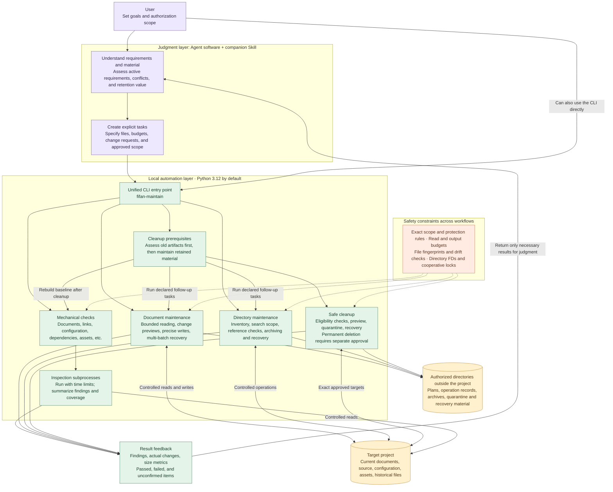
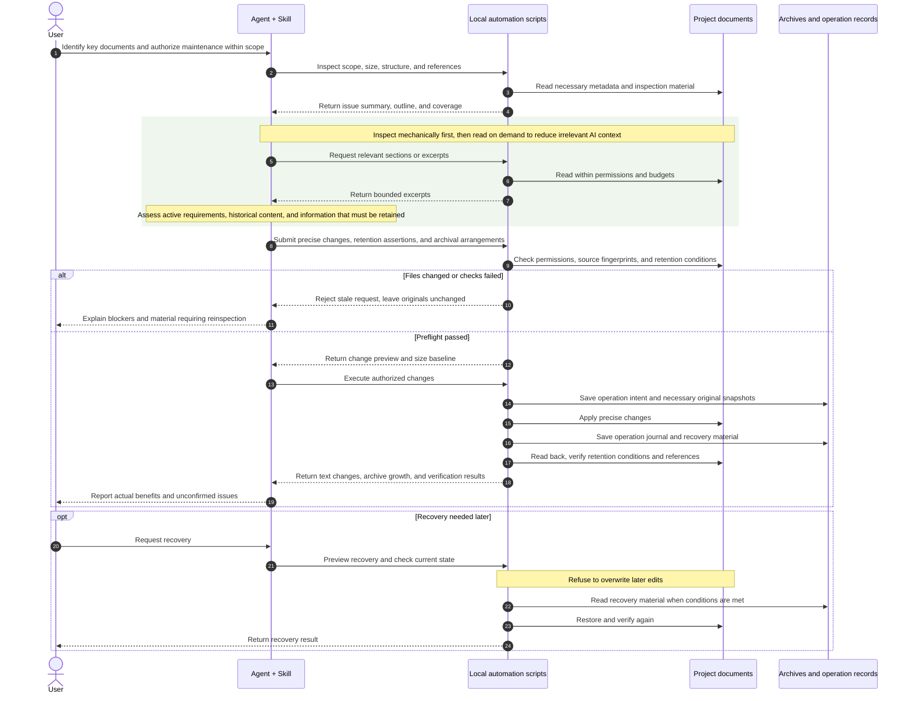

# Fifan Project Maintenance

Feature version **1.5.0** adds opt-in bounded reference batches/resume, reference review packs, explicit generated-build disposal, read-only joint navigation/archive previews, and literal preservation/binding advice. See [upgrade guide](docs/UPGRADE_1_5.md), [changelog](docs/CHANGELOG.md), and [validation scope](docs/VALIDATION.md). Legacy commands and profiles retain their default behavior.


**Project maintenance for Vibe Coding. Automation scripts handle most repetitive checks and mechanical file operations.**

Let AI read less unrelated material and focus on development.

[简体中文](README.md) · English · [www.fifanlabs.com](https://www.fifanlabs.com)

## Download 1.5.0

| Download | Contents |
| --- | --- |
| **[Full toolkit ZIP (recommended)](https://github.com/strobertwu-zeitfoto/fifan-project-maintenance/releases/download/v1.5.0/fifan-project-maintenance-1.5.0.zip)** | CLI source, Skill, documentation, examples and tests; Python/environment not bundled |
| [Companion Skill ZIP](https://github.com/strobertwu-zeitfoto/fifan-project-maintenance/releases/download/v1.5.0/fifan-project-maintenance-skill-1.5.0.zip) | Agent guidance; requires the CLI and its actual local path |
| [Python wheel](https://github.com/strobertwu-zeitfoto/fifan-project-maintenance/releases/download/v1.5.0/fifan_project_maintenance-1.5.0-py3-none-any.whl) | For an existing Python environment; installing dependencies may need network access |
| [SHA-256 checksums](https://github.com/strobertwu-zeitfoto/fifan-project-maintenance/releases/download/v1.5.0/SHA256SUMS) | Verify the three files above |

**[Installation](INSTALL.md#english-quick-start)** · [Release notes](https://github.com/strobertwu-zeitfoto/fifan-project-maintenance/releases/tag/v1.5.0) · [Latest release](https://github.com/strobertwu-zeitfoto/fifan-project-maintenance/releases/latest)

Recommended: macOS and Python 3.12. This is a local command-line toolkit; an Agent with local execution can install and operate it. See [validation scope](docs/VALIDATION.md).

## What does this do for me?

| Check your project | Slim active documents | Scripts first, AI judgment next |
| --- | --- | --- |
| Find broken links and reference problems | Shorter current instructions, retained history | Inspect in batches, read relevant passages |


The illustration is in Chinese. Its four steps are **your request → AI interpretation → script automation → result review**.

### Recorded outcomes

| Scenario | Outcome |
| --- | --- |
| One real-project Markdown guide | **41.5 KB → 4.9 KB**, 88.1% less active text |
| 13 important real-project documents | **794.6 KB → 209.0 KB**, 73.7% less active text |
| 20,005 historical files in a synthetic test | Metadata inspection with **zero body bytes read** |

These November 2026 cases include tool-and-Agent collaboration and labeled synthetic tests. Historical originals are retained separately. The figures are not measured token-saving percentages. [Details and measurement boundaries](docs/CASE_STUDIES.md)

Try asking your Agent:

> Check this project's important instructions and plans. Report problems first without modifying files. Inspect historical files with scripts, and read their contents only when a finding needs investigation. Keep reading and output small.

Mechanical checks make no model calls. Agent orchestration, interpretation, and editing still use your allowance. Application bugs need appropriate code review and runtime tests.


## Technical details

The local CLI provides document, link, configuration, dependency, asset, and evidence checks; bounded reading; precise change previews; journals; multi-batch recovery; directory inspection; search-view maintenance; same-volume archiving; and explicitly approved cleanup.

### Core capabilities and responsibilities

| Module | Automation scripts | Agent |
| --- | --- | --- |
| Document and reference checks | Check documents, links, and anchors; record issues and coverage gaps | Assess impact on the current task and decide how to fix issues |
| Configuration, dependencies, assets, and evidence | Check format, references, size, and signs of duplication against rules | Assess business meaning, retention value, and what needs further validation |
| Important Markdown maintenance | Bounded reading, change previews, precise writes, operation journals, and recovery verification | Retain active requirements, merge duplicate explanations, and distinguish current from historical content |
| History and directory maintenance | Inventory metadata, check search scope and references, and archive on the same volume | Select key directories and confirm archival eligibility; do not delete solely because no references were found |
| Safe cleanup prerequisites | Check old artifacts for eligibility, preview, quarantine, verify, and rebuild the baseline after cleanup | Confirm purpose and authorization; handle eligible cleanup first, then maintain retained material |
| Results and cost control | Enforce read/output budgets; summarize findings, actual changes, and unknowns | Read relevant highlights and explain results; do not invent model usage or savings percentages |

These capabilities are available on demand through one local CLI entry point, without requiring a persistent service, scheduled tasks, or Hooks. Scripts provide mechanical evidence; they do not replace business-code review, tests in the actual host, or user acceptance.

### Architecture: judgment and automation

The Agent and Skill interpret relevant material, decide what must be retained, and submit explicit requests. The local CLI and scripts perform bounded inspection, reading, previews, changes, and verification. The automation layer makes no model calls; scope, budgets, fingerprints, and cooperative locks constrain operations.

The architecture and swimlane diagrams below show the workflow and its safety boundaries. The architecture separates user authorization, Agent judgment, local automation, shared safeguards, project files, and external operation records.



### Signature workflow: slimming important Markdown documents

Scripts inspect first, then the Agent requests only relevant passages. A precise change request goes through permission, fingerprint, and retention checks before preview and authorized execution. Snapshots and journals support applicable recovery operations. Changed files or failed conditions stop the request; restoration also checks the current state and refuses to overwrite later edits. Permanent deletion is irreversible.



Active text reduction, archive growth, and external records are measured separately. Moving bytes is not total project shrinkage, and fewer bytes are not a measured token-saving percentage.

### Installation

Python3.12 is recommended. From the repository directory:

```bash
python3.12 -m venv .venv
.venv/bin/python -m pip install .
./bin/fifan-maintain --version
```

```bash
./bin/fifan-maintain check \
  --project /absolute/path/to/project \
  --files README.md \
  --preflight

./bin/fifan-maintain check \
  --project /absolute/path/to/project \
  --files README.md \
  --format summary
```

Installation may require network access; project checks run offline. The tool does not run target-project scripts/plugins or launch Unity. Archival/cleanup occupancy checks require lsof; search validation requires rg. Missing capabilities are reported, not automatically installed.

### Agent compatibility

**The CLI is model-independent and can be integrated with Agents that can run local commands.** The companion Skill follows a Codex workflow and requires configuration of the actual installation path. Other Agent products have not been individually validated; browser-only Agents without local command execution cannot invoke it directly.

### Platform and safety

- Python3.9 minimum; Python3.12 recommended/default. Validated on Intel macOS with3.9.6,3.12.14, and3.15.2.
- Some controlled operations use macOS-specific APIs. Version 1.5.0 has synthetic regression evidence on Apple Silicon/Python 3.12 (see Validation); Windows, Linux, free-threaded Python and real business-project acceptance remain unvalidated.
- Inspection is read-only by default. Changes, archiving, and cleanup require explicit scope and authorization. Permanent deletion is irreversible.
- Directory descriptors, fingerprints, and cooperative locks do not prevent every concurrent external write; pause other editors during changes.
- Keep reports, plans, and recovery material outside the target project as required; protect project text and credentials.


## Documentation

Detailed command documentation is primarily in Chinese.

- [Usage](docs/USAGE.md) · [Agent Skill](skill/SKILL.md)
- [Validation](docs/VALIDATION.md) · [Testing](docs/TESTING.md)
- [Dependencies and notices](docs/DEPENDENCIES.md) · [License status](NOTICE.md)

The maintainer has not selected a project license. Third-party notices are retained. Website: [www.fifanlabs.com](https://www.fifanlabs.com).
