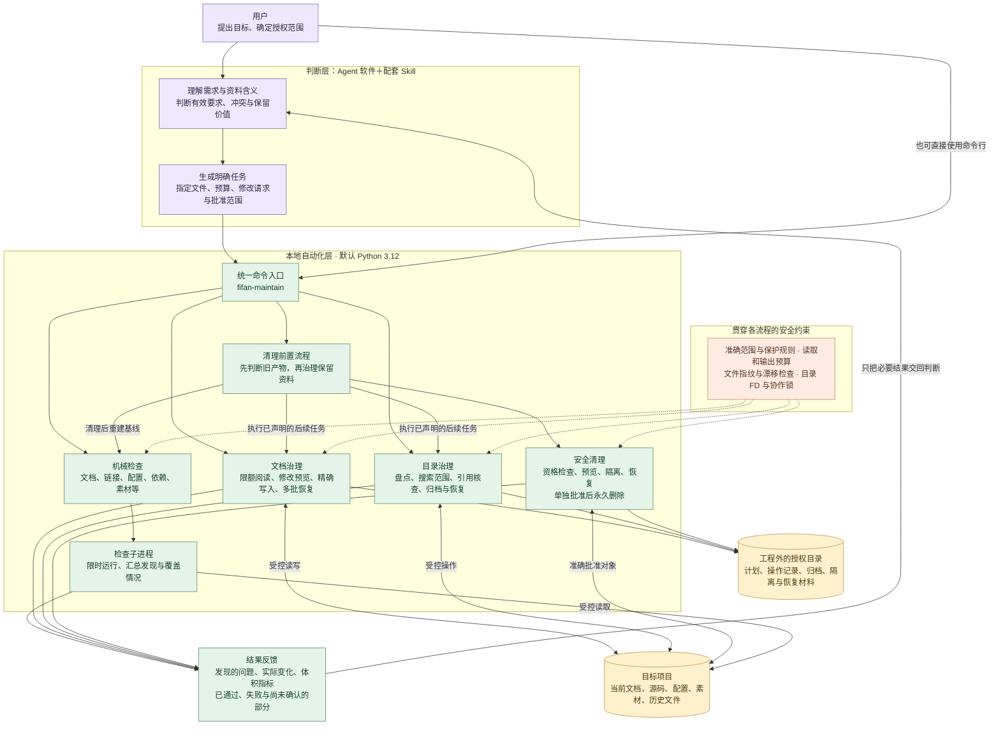
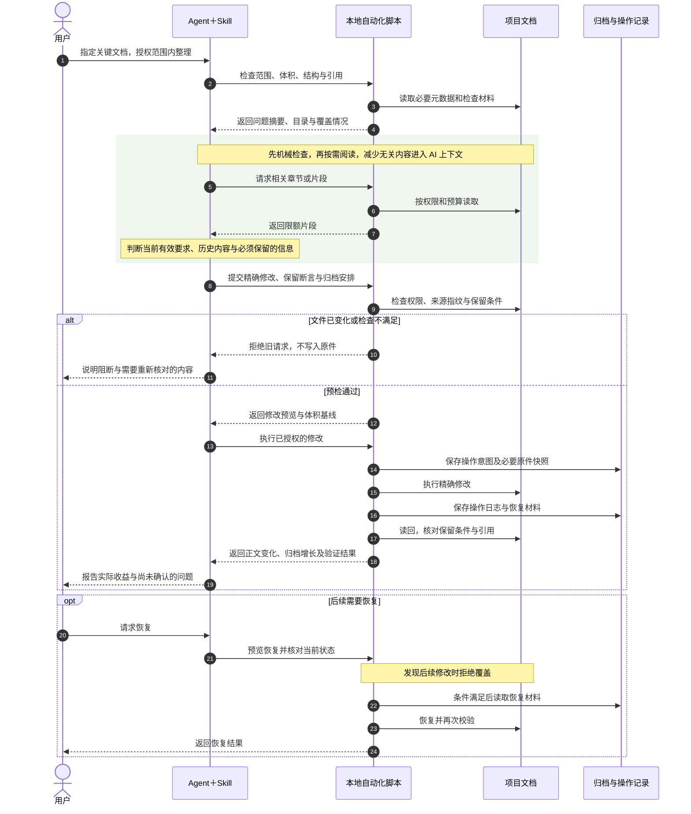

# Fifan 项目维护助手


**为 Vibe Coding 做项目维护。大部分重复检查与机械整理操作，由自动化脚本完成。**

AI 少翻文件，把 token 留给开发。

简体中文 · [English](README.en.md) · [官网 www.fifanlabs.com](https://www.fifanlabs.com)

## 下载 1.5.0

| 下载 | 内容 |
| --- | --- |
| **[完整工具包 ZIP（推荐）](https://github.com/strobertwu-zeitfoto/fifan-project-maintenance/releases/download/v1.5.0/fifan-project-maintenance-1.5.0.zip)** | CLI 源码、Skill、说明、示例及测试；不含 Python 或虚拟环境 |
| [配套 Skill ZIP](https://github.com/strobertwu-zeitfoto/fifan-project-maintenance/releases/download/v1.5.0/fifan-project-maintenance-skill-1.5.0.zip) | 给 Agent 使用的引导；仍需安装 CLI 并填入实际入口 |
| [Python wheel](https://github.com/strobertwu-zeitfoto/fifan-project-maintenance/releases/download/v1.5.0/fifan_project_maintenance-1.5.0-py3-none-any.whl) | 适合已有 Python 环境的用户，依赖安装可能需要联网 |
| [SHA-256 校验文件](https://github.com/strobertwu-zeitfoto/fifan-project-maintenance/releases/download/v1.5.0/SHA256SUMS) | 校验上述三个文件 |

**[安装步骤](INSTALL.md)** · [1.5.0 发行说明](https://github.com/strobertwu-zeitfoto/fifan-project-maintenance/releases/tag/v1.5.0) · [查看最新版本](https://github.com/strobertwu-zeitfoto/fifan-project-maintenance/releases/latest)

推荐 macOS + Python 3.12。这是本地命令行工具；Agent 可代为安装和使用。平台验证范围见 [验证说明](docs/VALIDATION.md)。

## 先看看能帮你什么

| 给项目做体检 | 给文档减减肥 | 脚本先做，AI再看 |
| --- | --- | --- |
| 找出失效链接和资料问题 | 当前说明变短，历史仍保留 | 批量检查，按需读取重点 |


### 已有记录的效果

| 场景 | 结果 |
| --- | --- |
| 真实项目的一份MD说明 | **41.5 KB → 4.9 KB**，当前正文减少88.1% |
| 真实项目13份关键MD | **794.6 KB → 209.0 KB**，当前正文减少73.7% |
| 测试中的20,005份历史文件 | 机械盘点，**正文读取0字节** |

这些是2026年11月的真实协作案例和合成测试，历史原件另行保留，不代表固定token节省比例。[更多案例与统计口径](docs/CASE_STUDIES.md)

你可以这样提需求：

> 检查这个项目最重要的说明和计划，先列问题，不修改。旧文件先让脚本查，有疑点再让AI读相关内容，尽量少读、少输出。

机械检查不调用模型；AI发起操作、解释或改写仍消耗额度。程序业务bug还需要相应代码检查和运行测试。


## 技术说明

本地CLI提供文档/链接/配置/依赖/素材/证据等检查、限额读取、精确修改预览、操作日志、多批恢复、目录盘点、搜索范围治理、同卷归档和明确授权的清理。配套Skill负责引导Agent限定范围与解释结果。

### 核心能力与分工

| 模块 | 自动化脚本负责什么 | Agent 负责什么 |
| --- | --- | --- |
| 文档与引用体检 | 检查文档、链接和锚点，记录问题与覆盖缺口 | 判断问题是否影响当前任务，确认修复方式 |
| 配置、依赖、素材与证据 | 按规则检查格式、引用、体积与重复线索 | 判断业务含义、保留价值和需要进一步验证的内容 |
| 关键 MD 治理 | 限额读取、修改预览、精确写入、操作日志与恢复核验 | 保留有效要求，合并重复说明，区分当前与历史 |
| 历史与目录治理 | 元数据盘点、搜索范围检查、引用核查和同卷归档 | 选择关键目录，确认归档资格，不凭“没引用”删除 |
| 安全清理前置 | 先检查旧产物资格，预览、隔离、核验，并在清理后重建基线 | 核实用途与授权，先处理可清理项，再治理保留资料 |
| 结果与成本控制 | 执行读取/输出预算，汇总发现、真实变化与未知项 | 按需看重点，解释结果；不编造模型用量或节省比例 |

这些能力通过同一个本地命令入口按需调用，不要求启用常驻服务、定时任务或 Hook。脚本提供机械证据，不能代替业务代码审查、宿主运行测试或用户验收。

### 架构图：谁判断，谁干活？

Agent 和 Skill 负责理解资料、判断保留内容并提出明确请求；本地 CLI 及脚本负责批量检查、限额读取、精确操作和核验。脚本内部不调用大模型，安全约束贯穿各条操作路径。



### 招牌功能泳道图：关键 MD 瘦身

先让脚本筛查，再让 AI 只读相关片段。修改前预览，保留必要历史与操作记录，完成后检查正文、保留条件和引用。文件被后改或条件不满足时停止；恢复同样需要核对当前状态，永久删除不属于可恢复修改。



正文缩小、历史归档增长和工程外记录分别统计；不把转移占用当作整个项目变小，也不把字节减少直接换算成 token 节省。

### 安装

当前功能版本 **1.5.0**：新增分批引用/续办、动态提示复核包、明确生成物清理合同、导航与归档联合预演及字面保留检查。见 [1.5 使用说明](docs/UPGRADE_1_5.md)、[版本记录](docs/CHANGELOG.md) 与 [工程计划](docs/ENGINEERING_PLAN.md)。旧命令/profile默认行为保留。

下载完整工具包并解压，或克隆本仓库；完整步骤及独立 Skill 安装见 [INSTALL.md](INSTALL.md)。

推荐Python3.12；进入本仓库目录后：

```bash
python3.12 -m venv .venv
.venv/bin/python -m pip install .
./bin/fifan-maintain --version
```

```bash
./bin/fifan-maintain check \
  --project /absolute/path/to/project \
  --files README.md \
  --preflight

./bin/fifan-maintain check \
  --project /absolute/path/to/project \
  --files README.md \
  --format summary
```

依赖安装可能需要网络；项目检查离线。CLI不执行被检查项目的脚本/插件，不启动Unity。归档/清理的占用检查需要lsof，搜索验证需要rg；缺少能力时报告受阻，不自行安装。

### Agent兼容性

**CLI不绑定模型，可供支持本地命令执行的Agent接入。** 配套Skill按Codex工作流配置，需填入实际安装入口；其他Agent软件尚未逐一验证，浏览器专用或不能运行本地命令的Agent不能直接调用。

### 平台与安全

- 最低兼容Python3.9，推荐并默认3.12；已验证Intel macOS的3.9.6、3.12.14、3.15.2。
- 部分受控操作使用macOS专用接口；1.5.0已在Apple Silicon / Python3.12上完成临时样例回归，范围见[验证记录](docs/VALIDATION.md)。不宣称真实工程、Windows、Linux或自由线程Python通过验收。
- 默认检查不改目标。修改、归档与删除按明确范围和授权执行；永久删除不可恢复。
- 目录FD、文件指纹与协作锁保留；其他编辑者仍须暂停，不能保证阻止所有并发外部写入。
- 报告、计划和恢复材料按要求放在目标工程外，不上传项目原文或凭据。


## 文档

- [使用说明](docs/USAGE.md) · [Agent Skill](skill/SKILL.md)
- [验证与限制](docs/VALIDATION.md) · [开发测试](docs/TESTING.md)
- [依赖与第三方声明](docs/DEPENDENCIES.md) · [许可状态](NOTICE.md)

项目许可证尚未选定；第三方声明保留。官网：[www.fifanlabs.com](https://www.fifanlabs.com)。
